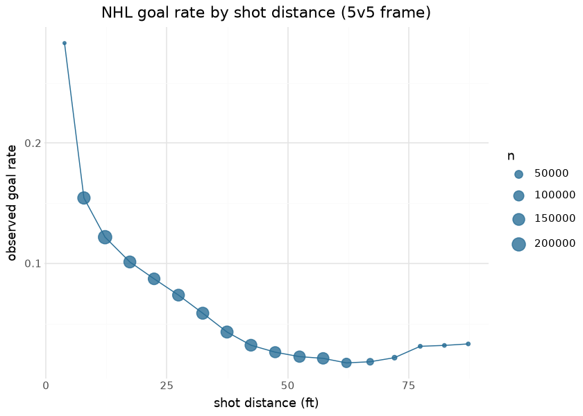
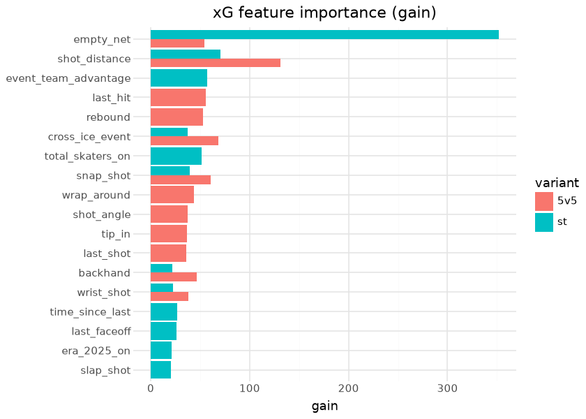
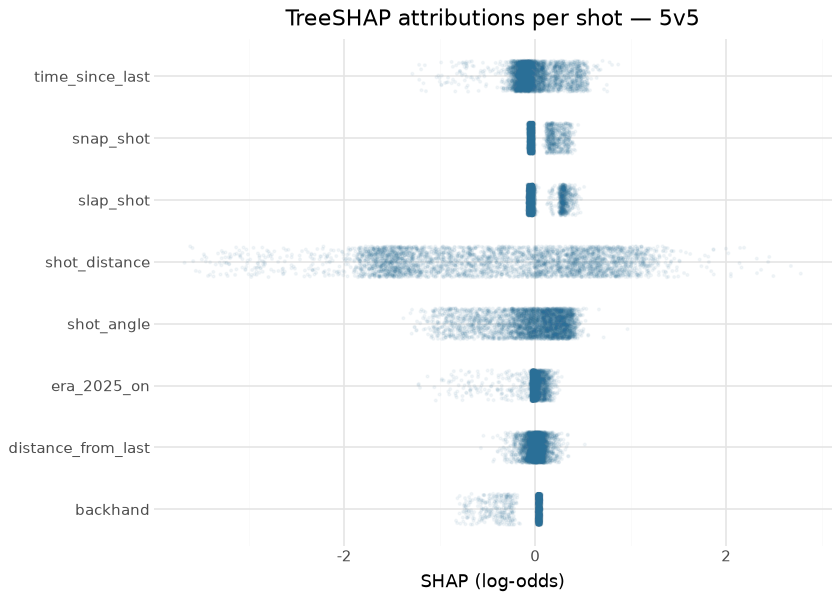
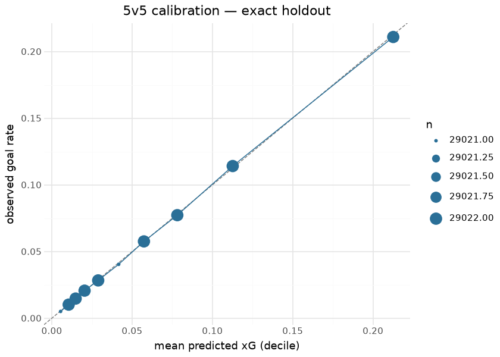
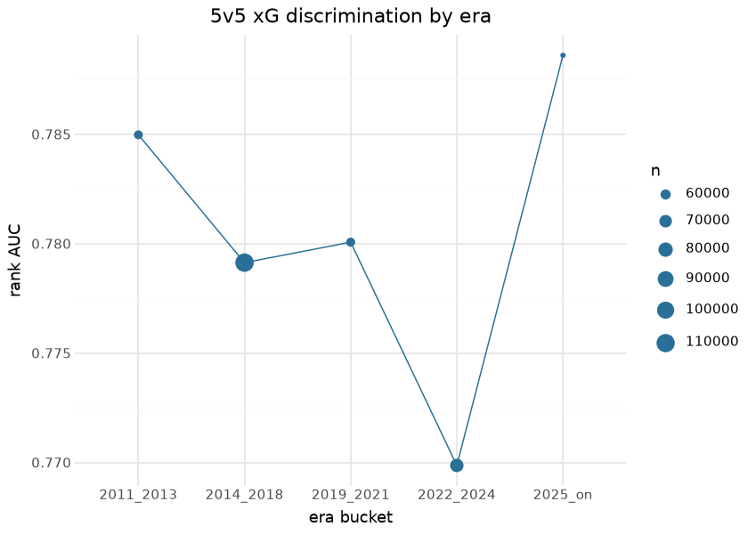
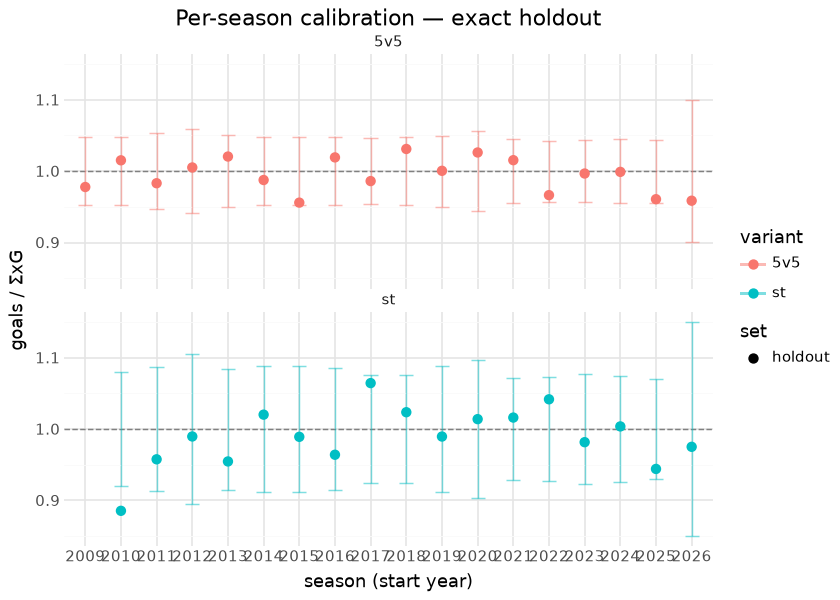

# NHL Expected Goals (fastRhockey xG suite)

The fastRhockey xG suite estimates the probability that an unblocked
shot becomes a goal, in two strength regimes: **5v5** (all non-shootout,
non-penalty-shot unblocked shots) and **special teams** (power play /
short-handed). A third component, the **penalty-shot constant**, is the
historical conversion rate computed at train time. The suite’s output
ships as the xG columns inside every published `nhl_pbp_full` season
asset — the model never ships alone; it reaches consumers embedded in
the play-by-play.

The models are XGBoost binary classifiers (logloss objective), a
faithful reproduction lineage of the hockeyR xG recipe (Morse 2022),
re-fit on this repository’s own committed corpus by
`python/nhl_data_build/xg_train.py` (canonical R twin
`R/build_xg_model.R`). The fitted boosters are **committed in this
repo** (`models/xg_model_{5v5,st}.json`) — that is the promotion step —
and every figure and number below is computed at render time from those
committed artifacts plus the committed play-by-play. The python trainer
also writes two sidecars beside the boosters, `xg_model_meta.json`
(feature lists, training-time CV and holdout metrics, per-season
calibration) and `xg_model_split.json` (the train/test `game_id`
partition); when they are committed the evaluation below scores the
*exact* held-out games, otherwise it replays the trainer’s split recipe
on today’s corpus and labels the result a near-holdout.

## Training data

| Committed NHL play-by-play corpus, by season |  |  |  |
|----|----|----|----|
| unblocked shot events (SHOT / MISSED_SHOT / GOAL); computed at render time |  |  |  |
| season | games | fenwick_events | goal_share |
| 20092010 | 1317 | 111,805 | 6.9% |
| 20102011 | 1318 | 112,525 | 6.7% |
| 20112012 | 1316 | 110,029 | 6.7% |
| 20122013 | 806 | 66,752 | 6.7% |
| 20132014 | 1323 | 112,057 | 6.7% |
| 20142015 | 1319 | 110,923 | 6.7% |
| 20152016 | 1321 | 110,264 | 6.6% |
| 20162017 | 1317 | 111,712 | 6.6% |
| 20172018 | 1355 | 120,553 | 6.8% |
| 20182019 | 1358 | 118,441 | 7.0% |
| 20192020 | 1212 | 105,036 | 7.0% |
| 20202021 | 952 | 79,119 | 7.1% |
| 20212022 | 1401 | 122,350 | 7.3% |
| 20222023 | 1400 | 122,711 | 7.4% |
| 20232024 | 1400 | 123,136 | 7.1% |
| 20242025 | 1398 | 120,462 | 7.1% |
| 20252026 | 1394 | 120,154 | 7.4% |
| 20262027 | 298 | 25,107 | 7.6% |

&#10;

Training corpus: this repository’s committed play-by-play
(`nhl/pbp/parquet/`, seasons listed above, ~13.6M events). Seasons are
grouped into **five era buckets** (2011–2013, 2014–2018, 2019–2021,
2022–2024, 2025-on) that enter as one-hot features, so rule- and
tracking-era shifts are modeled rather than silently biasing the fit.
The 5v5/ST split is a modeling decision, not a convenience: shooting
talent and shot-quality distributions differ enough across strength
states that a single pooled model miscalibrates the power play.

## Exploratory data analysis

| Shot-type mix and conversion (5v5 frame) |         |           |
|------------------------------------------|---------|-----------|
| shot_type                                | shots   | goal_rate |
| wrist_shot                               | 927,648 | 6.6%      |
| slap_shot                                | 321,165 | 4.2%      |
| snap_shot                                | 281,365 | 7.7%      |
| backhand                                 | 139,109 | 8.5%      |
| tip_in                                   | 127,916 | 9.5%      |
| deflected                                | 38,871  | 9.6%      |
| wrap_around                              | 17,147  | 5.1%      |
| batted                                   | 1,944   | 11.9%     |
| poke                                     | 1,864   | 12.9%     |
| between_legs                             | 321     | 9.7%      |
| cradle                                   | 36      | 13.9%     |

&#10;

Distance dominates conversion — from ~25% at the crease to ~2% beyond 60
ft — and the shot-type table explains the one-hot block: tips and
deflections convert well above wrist shots from similar range, and the
model needs the type to separate them. The special-teams frame adds
`total_skaters_on` and `event_team_advantage`, the two features that
encode the man-advantage state.

## Feature importance

| Top 12 features by gain — 5v5 booster (committed artifact) |          |
|------------------------------------------------------------|----------|
| feature                                                    | gain_5v5 |
| empty_net                                                  | 559.4    |
| rebound                                                    | 131.6    |
| shot_distance                                              | 123.6    |
| snap_shot                                                  | 67.0     |
| cross_ice_event                                            | 56.0     |
| backhand                                                   | 51.9     |
| wrap_around                                                | 47.4     |
| slap_shot                                                  | 46.6     |
| last_hit                                                   | 46.0     |
| wrist_shot                                                 | 44.7     |
| era_2025_on                                                | 39.7     |
| shot_angle                                                 | 33.2     |

&#10;

## SHAP

TreeSHAP attributions come directly from the committed boosters
(`pred_contribs=True` — exact for tree ensembles, no extra dependency).
The distribution of per-shot attributions for the top features shows how
each one moves individual shots on the log-odds scale:

| Mean \|SHAP\| — 5v5 booster, 4,000-shot sample |               |
|------------------------------------------------|---------------|
| feature                                        | mean_abs_shap |
| shot_distance                                  | 0.8763        |
| shot_angle                                     | 0.2620        |
| time_since_last                                | 0.1376        |
| slap_shot                                      | 0.1011        |
| empty_net                                      | 0.0920        |
| snap_shot                                      | 0.0743        |
| backhand                                       | 0.0645        |
| distance_from_last                             | 0.0630        |

&#10;

## Evaluation

Two views, honestly labeled. First, the **training-time metrics**:
grouped 5-fold CV on the 80% side (the gated number) and the
game-grouped 20% holdout the fit never saw. They come from
`models/xg_model_meta.json` when a python sidecar is committed,
otherwise from the 2026-04 R fit’s console output in the README (CV only
— that run persisted no holdout metrics and no partition, which is
exactly what the sidecars fix). The gate floors (`_CV_AUC_FLOOR` per
stage) sit just below an observed fit — re-derived 2026-11-12 from the
complete-corpus fit (5v5 cv AUC ≥ 0.77, ST ≥ 0.75) — and are never
lowered; a real retrain below them fails (`--quick` smoke runs tolerate
misses).

**Sidecar state:** `xg_model_meta.json` + `xg_model_split.json` are
committed — the holdout below is the exact training-time partition (fit
2026-11-12).

| Training-time metrics |  |  |  |  |  |  |  |  |  |  |  |
|----|----|----|----|----|----|----|----|----|----|----|----|
| grouped 5-fold CV on the 80% side; game-grouped 20% holdout; floors re-derived from an observed fit, never lowered |  |  |  |  |  |  |  |  |  |  |  |
| variant | source | train shots | holdout shots | holdout games | CV AUC | CV log-loss | holdout AUC | holdout log-loss | baseline log-loss | gate | passes |
| 5v5 | xg_model_meta.json (fit 2026-11-12) | 1,485,915 | 372,192 | 4,441 | 0.7787 | 0.2116 | 0.7797 | 0.2112 | 0.2476 | cv AUC ≥ 0.77 | True |
| st | xg_model_meta.json (fit 2026-11-12) | 303,626 | 75,335 | 4,141 | 0.7570 | 0.2825 | 0.7557 | 0.2806 | 0.3283 | cv AUC ≥ 0.75 | True |

&#10;

Second, the **held-out games re-scored at render time** by the committed
boosters. With a committed split file this is today’s corpus filtered to
the persisted `test_game_ids`; games that landed after the fit are in
neither list and are reported separately as **out-of-time** shots — an
honest forward test that grows as seasons land — and `Δ vs meta`
(render-time holdout AUC minus the meta’s) is exactly 0 unless the
committed play-by-play was repaired after the fit. Without a split file
the set is the seed-37 replay described above.

| Held-out evaluation — exact holdout (render-time, current corpus) |  |  |  |  |  |  |  |  |
|----|----|----|----|----|----|----|----|----|
| test_game_ids from models/xg_model_split.json; 0 post-fit games in the out-of-time set |  |  |  |  |  |  |  |  |
| variant | set | shots | games | goal_rate | logloss | baseline_logloss | rank_AUC | Δ vs meta |
| 5v5 | exact holdout | 372,192 | 4,441 | 6.8% | 0.2112 | 0.2476 | 0.7797 | 0.0000 |
| st | exact holdout | 75,335 | 4,141 | 10.1% | 0.2806 | 0.3283 | 0.7557 | 0.0000 |
| 5v5 | out-of-time (post-fit games) | 0 | 0 | — | — | — | — | — |
| st | out-of-time (post-fit games) | 0 | 0 | — | — | — | — | — |

&#10;

The penalty-shot constant computed from the current corpus:

| Penalty-shot xG constant (historical conversion rate) |        |
|-------------------------------------------------------|--------|
| component                                             | xG     |
| penalty-shot / shootout constant                      | 0.3184 |

&#10;

## Per-season calibration drift

The special-teams sample is ~5× smaller than 5v5, so its AUC floor alone
cannot see a season whose *level* drifts — a rule or tracking change
that shifts conversion without reordering shots. The monitor is the
binomial calibration z-score per season,
`z = (goals − ΣxG) / sqrt(ΣxG · (1 − xG))`: a season the model prices
correctly has \|z\| ~ N(0, 1) whatever its shot count, which is what
makes `max |z|` comparable across seasons of unequal size. The trainer
records this table in `info_st.per_season_calibration` at every retrain
(`xg_train.per_season_calibration`), and stage `nhl_model_02_xg_st`
gates on `max |z| ≤ _ST_DRIFT_MAX_ABS_Z` — a ceiling derived from the
value observed on the exact holdout of the trusted retrain and never
raised (see `models/REGISTRY.md`). The same statistic is recomputed here
at render time on the held-out shots, with post-fit seasons appended as
out-of-time rows.

| Special-teams calibration by season — exact holdout (+ out-of-time) |  |  |  |  |  |  |  |
|----|----|----|----|----|----|----|----|
| ratio = goals / ΣxG; z = binomial calibration z-score; auc = per-season rank AUC |  |  |  |  |  |  |  |
| set | season | n | goals | xg_sum | ratio | z | auc |
| holdout | 2010 | 5,222 | 435 | 491.3 | 0.885 | −2.85 | 0.740 |
| holdout | 2011 | 4,626 | 404 | 421.9 | 0.958 | −0.97 | 0.798 |
| holdout | 2012 | 3,043 | 284 | 287.0 | 0.990 | −0.20 | 0.740 |
| holdout | 2013 | 4,898 | 427 | 447.3 | 0.955 | −1.07 | 0.749 |
| holdout | 2014 | 4,397 | 416 | 407.8 | 1.020 | 0.46 | 0.759 |
| holdout | 2015 | 4,294 | 407 | 411.5 | 0.989 | −0.25 | 0.750 |
| holdout | 2016 | 4,409 | 415 | 430.5 | 0.964 | −0.84 | 0.751 |
| holdout | 2017 | 5,487 | 581 | 545.8 | 1.064 | 1.71 | 0.757 |
| holdout | 2018 | 4,900 | 537 | 524.6 | 1.024 | 0.62 | 0.746 |
| holdout | 2019 | 3,893 | 399 | 403.2 | 0.990 | −0.24 | 0.757 |
| holdout | 2020 | 2,982 | 330 | 325.5 | 1.014 | 0.29 | 0.769 |
| holdout | 2021 | 5,526 | 598 | 588.5 | 1.016 | 0.45 | 0.758 |
| holdout | 2022 | 5,408 | 613 | 588.5 | 1.042 | 1.15 | 0.737 |
| holdout | 2023 | 4,699 | 513 | 522.6 | 0.982 | −0.48 | 0.768 |
| holdout | 2024 | 4,967 | 558 | 555.9 | 1.004 | 0.10 | 0.750 |
| holdout | 2025 | 5,348 | 587 | 621.8 | 0.944 | −1.59 | 0.758 |
| holdout | 2026 | 1,236 | 139 | 142.6 | 0.975 | −0.33 | 0.718 |

&#10;

| Stage gates (nhl_model_02_xg_st.st_gates)           |          |           |      |
|-----------------------------------------------------|----------|-----------|------|
| evaluated on the committed xg_model_meta.json       |          |           |      |
| check                                               | observed | threshold | pass |
| cv AUC ≥ 0.75                                       | 0.757    | 0.75      | True |
| ST drift: max \|z\| over held-out seasons ≤ ceiling | 2.846    | 3.0       | True |
| stage verdict                                       |          |           | True |

&#10;

Both boosters carry era one-hots, so a booster fit on this frame sits
inside the band in every season it was trained on; the informative rows
are the out-of-time ones, which is where a level drift first shows.

## Results — players and teams

| Top 15 skaters by 5v5 expected goals — season 2026-2027 |  |  |  |  |  |  |
|----|----|----|----|----|----|----|
| unblocked 5v5 shots scored by the committed booster; GAX = goals above expected |  |  |  |  |  |  |
|  | Player | Team | Shots | xG | G | GAX |
|  | Kirill Kaprizov | MIN | 108 | 13.49 | 15 | 1.51 |
|  | Sam Reinhart | FLA | 91 | 10.97 | 10 | −0.97 |
|  | Leon Draisaitl | EDM | 113 | 10.74 | 16 | 5.26 |
|  | Brandon Hagel | TBL | 99 | 10.55 | 11 | 0.45 |
|  | Joel Eriksson Ek | MIN | 93 | 10.42 | 6 | −4.42 |
|  | Kyle Connor | WPG | 117 | 10.35 | 15 | 4.65 |
|  | Jack Hughes | NJD | 108 | 10.10 | 9 | −1.10 |
|  | Viktor Arvidsson | DET | 82 | 9.88 | 8 | −1.88 |
|  | Matt Boldy | MIN | 119 | 9.58 | 7 | −2.58 |
|  | Cutter Gauthier | ANA | 116 | 8.97 | 16 | 7.03 |
|  | Auston Matthews | TOR | 104 | 8.94 | 11 | 2.06 |
|  | Brady Tkachuk | FLA | 98 | 8.81 | 10 | 1.19 |
|  | Tomas Hertl | VGK | 71 | 8.75 | 9 | 0.25 |
|  | Logan Stankoven | CAR | 79 | 8.54 | 11 | 2.46 |
|  | Cole Perfetti | WPG | 85 | 8.50 | 6 | −2.50 |

&#10;

| Team 5v5 shot generation — season 2026-2027 |       |        |           |       |
|---------------------------------------------|-------|--------|-----------|-------|
| team                                        | shots | xG_for | goals_for | GAX   |
| CAR                                         | 931   | 71.8   | 75        | 3.2   |
| MIN                                         | 894   | 71.6   | 63        | −8.6  |
| VGK                                         | 846   | 67.1   | 66        | −1.1  |
| UTA                                         | 872   | 66.5   | 64        | −2.5  |
| NYR                                         | 771   | 66.2   | 58        | −8.2  |
| NJD                                         | 894   | 65.2   | 64        | −1.2  |
| TBL                                         | 785   | 63.8   | 68        | 4.2   |
| FLA                                         | 846   | 63.7   | 59        | −4.7  |
| COL                                         | 847   | 63.6   | 77        | 13.4  |
| ANA                                         | 749   | 61.3   | 71        | 9.7   |
| DET                                         | 817   | 60.4   | 49        | −11.4 |
| OTT                                         | 744   | 60.4   | 54        | −6.4  |
| PIT                                         | 800   | 59.5   | 58        | −1.5  |
| SJS                                         | 854   | 58.7   | 51        | −7.7  |
| BUF                                         | 762   | 58.7   | 53        | −5.7  |
| NSH                                         | 753   | 58.6   | 58        | −0.6  |
| MTL                                         | 774   | 58.2   | 59        | 0.8   |
| TOR                                         | 847   | 57.3   | 64        | 6.7   |
| EDM                                         | 776   | 57.0   | 77        | 20.0  |
| WPG                                         | 796   | 56.0   | 51        | −5.0  |
| BOS                                         | 722   | 56.0   | 67        | 11.0  |
| PHI                                         | 746   | 53.9   | 46        | −7.9  |
| WSH                                         | 651   | 53.2   | 54        | 0.8   |
| STL                                         | 701   | 53.0   | 53        | −0.0  |
| CGY                                         | 798   | 51.9   | 46        | −5.9  |
| DAL                                         | 657   | 49.5   | 45        | −4.5  |
| LAK                                         | 690   | 48.7   | 45        | −3.7  |
| NYI                                         | 657   | 48.6   | 47        | −1.6  |
| VAN                                         | 675   | 46.8   | 56        | 9.2   |
| CHI                                         | 646   | 46.2   | 38        | −8.2  |
| CBJ                                         | 625   | 43.7   | 37        | −6.7  |
| SEA                                         | 595   | 42.3   | 53        | 10.7  |

&#10;

Positive GAX marks finishing above shot quality. At the team level,
xG-for minus goals-for separates shot-generation strength from shooting
luck — the spread between the two is exactly what the embedded xG
columns in `nhl_pbp_full` exist to expose.

## Provenance & reproducibility

- **Trained on:** this repository’s committed play-by-play
  (`nhl/pbp/parquet/`, seasons in the corpus table above); committed
  boosters = the python 2026-11-12 fit (`nhl_model_pipeline.yml` run
  43181159544); grouped 80/20 split by `game_id`, grouped 5-fold CV for
  `min_child_weight`, seed 37 (the python trainer persists the partition
  in `models/xg_model_split.json`).
- **Artifacts:** `models/xg_model_5v5.json`, `models/xg_model_st.json`
  (committed — the promotion step); python sidecars
  `models/xg_model_meta.json` (feature lists, CV + exact-holdout
  metrics, per-season calibration, PS constant) and
  `models/xg_model_split.json`, committed with the boosters; every stage
  run appends a `models/ledger.jsonl` line (including failed ones).
  Output ships inside `nhl_pbp_full`.
- **Retrain:** `scripts/nhl_models.sh` (stages `nhl_model_01_xg_5v5` /
  `nhl_model_02_xg_st`; fingerprint-skipped when unchanged, `--force` to
  retrain); gates recorded in `models/manifest.yaml` (cv AUC floors +
  the ST per-season drift ceiling), registry row in
  `models/REGISTRY.md`.
- **Rebuild this document:** `scripts/render_model_docs.sh` (Quarto →
  GFM; uses this repo’s `.venv` via `QUARTO_PYTHON`;
  `uv sync --group docs --group train`).

## Avenues for improvement & open issues

- **Pre-shot context** — rush/rebound flags exist, but passing sequences
  and screens do not; public-feed models plateau here, so the honest
  gain is better rebound/rush definitions, not more trees.
- **Resolved (2026-11-12):** *Commit the python sidecars / exact
  holdout* — the 2026-11-12 retrain passed the re-derived floors and
  committed `xg_model_meta.json` + `xg_model_split.json`; the evaluation
  above is the exact training-time holdout.
- **Resolved (2026-09-01, PR \#7):** *Per-season ST calibration drift* —
  monitored by the per-season table and figure above; the trainer
  records the statistic in the meta and stage `nhl_model_02_xg_st` gates
  on the observed-value-derived ceiling `max |z| ≤ _ST_DRIFT_MAX_ABS_Z`.
- **Resolved (2026-11-12):** the 2026-04 R boosters over-predicted goals
  by 25–30% through 2023-24 on this frame because they were fitted on a
  corpus carrying no missed shots (settled 2026-09-02; the R and python
  recipes match on real games). They are replaced by the python fit on
  the complete corpus, calibrated per season (5v5 max \|z\| 1.84, ST
  2.85 under the 3.0 ceiling). The published pbp `xg` column keeps the
  2026-04 scores until it is rescored.
